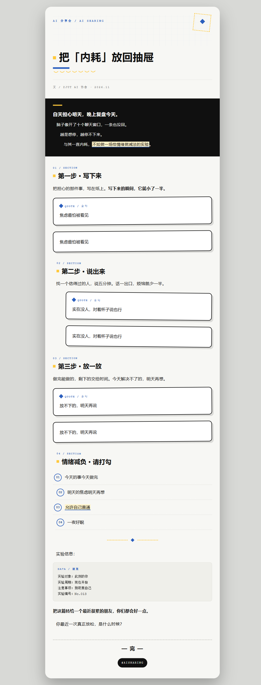
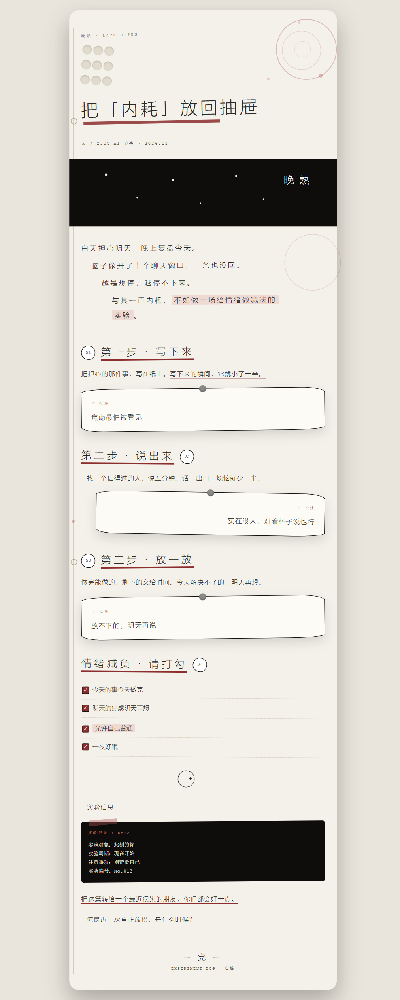
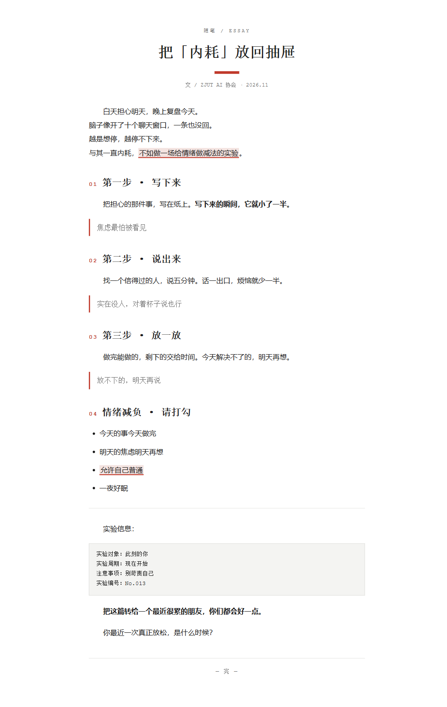
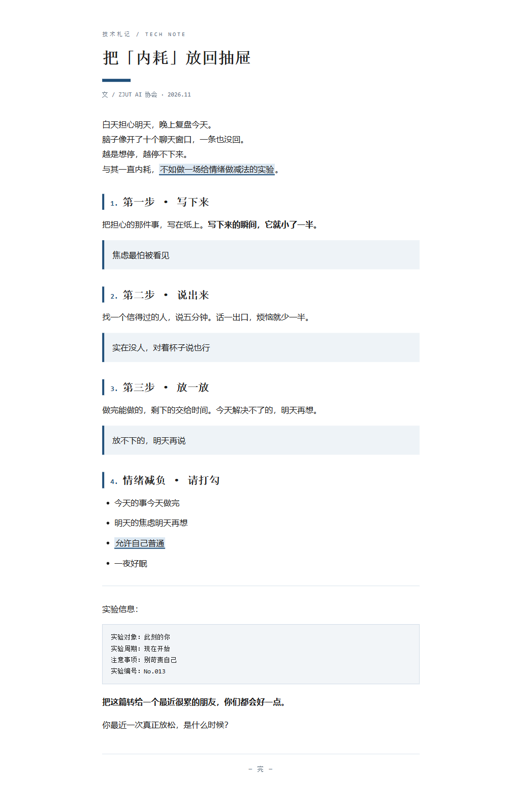

# 公众号文字稿一键排版助手

把写好的文字稿转换成**可以直接粘贴进微信公众号编辑器**的 HTML。不用懂设计，一条命令出成品，并且自带排版质量检查。

## 项目简介

很多学生社团和自媒体新手能写出内容，却卡在排版上：字体、字号、行高、留白、配色全靠试，做出来还经常"不好看"；好不容易排好，粘贴进公众号编辑器后样式又丢了。

本项目把排版拆成三件事，并全部自动化：

1. **解析**文字稿的结构（标题、小节、引用、列表、重点句）
2. **渲染**成内联样式的单文件 HTML（公众号粘贴不丢样式）
3. **检查**排版质量（对比度、字号、行高、外链、禁用标签）

项目以 **Agent Skill** 的形式交付：AI 读取 `SKILL.md` 后知道何时调用、如何调用；核心功能由可独立运行的 Python 脚本完成，不依赖任何第三方库。

## 核心功能

- 支持 `.txt` / `.md` 文字稿，自动识别标题、小节、引用、列表、代码块
- 内置 4 套风格：科技蓝分享会风、杨梅晚熟风、极简书卷风、学术理工风
- 支持 `--accent` 自定义点缀色
- 生成单文件 HTML，全部内联样式，无 JS、无外链、无外部字体
- 自动排版检查：7 项（禁用标签、容器宽度、标题数量、外链、内联样式、对比度、字号行高）
- 可选作者、日期署名

## 技术栈

- Python 3.9+（仅标准库）
- Agent Skill（`SKILL.md` + `scripts/` + `styles/`）
- `unittest` 自动化测试

没有任何第三方依赖，不需要 API Key。

## 安装方法

1. 安装 Python 3.9 或更高版本
2. 下载或克隆本项目
3. 不需要 `pip install`（`requirements.txt` 仅作说明）

## 运行方法

在项目根目录执行：

```bash
# 喜茶风
python skill/wechat-article-typesetter/scripts/typeset.py examples/sample-article.md --style heytea --author "化工小张" --output examples/output/sample-heytea.html --validate

# 极简风
python skill/wechat-article-typesetter/scripts/typeset.py examples/sample-article.md --style minimal --output examples/output/sample-minimal.html --validate

# 学术风
python skill/wechat-article-typesetter/scripts/typeset.py examples/sample-article.md --style academic --output examples/output/sample-academic.html --validate
```

也可以用 Skill 目录内的相对路径：

```bash
cd skill/wechat-article-typesetter
python scripts/typeset.py ../../examples/sample-article.md --style heytea --output ../../examples/output/sample-heytea.html --validate
```

### 命令行参数

| 参数 | 说明 |
|---|---|
| `input` | 输入文件（`.txt` / `.md`，UTF-8） |
| `--style` | `heytea`（默认）/ `minimal` / `academic` |
| `--title` | 文章标题；不填则取文件第一行 |
| `--author` | 作者署名 |
| `--date` | 日期文字 |
| `--accent` | 点缀色，`#RRGGBB` |
| `--output`, `-o` | 输出 HTML 路径 |
| `--validate` | 生成后自动检查 |
| `--list-styles` | 列出内置风格 |

### 把 HTML 粘贴进公众号

1. 双击生成的 HTML，用浏览器打开
2. 从标题开始，选中到文末"— 完 —"
3. 复制
4. 打开公众号后台编辑器和文章，粘贴
5. 图片、封面在公众号编辑器里手动补充

## 示例输入

`examples/sample-article.md` 节选：

```markdown
# 把「内耗」放回抽屉

白天担心明天，晚上复盘今天。
脑子像开了十个聊天窗口，一条也没回。
越是想停，越停不下来。
与其一直内耗，==不如做一场给情绪做减法的实验==。

## 第一步 · 写下来

把担心的那件事，写在纸上。**写下来的瞬间，它就小了一半。**

> 焦虑最怕被看见
```

## 示例输出

生成的是单文件 HTML，核心特征：

- 容器宽度 `677px`，页面居中
- 标题区：风格化小标签 + 大标题 + 点缀色短横条
- 小节自动编号（`01` / `1.`）
- 引用、列表、代码块、分隔线均有独立样式
- 文末固定"— 完 —"
- 无任何外部资源，断网也能正常显示

可查看 `examples/output/` 下四套风格的生成结果。

另外 `examples/showcase/neihao-heytea-handcrafted.html` 是同一篇文字稿的「白纸实验手账」手工精排版范本（由项目沉淀的设计配方制作），用于展示这套工具背后的设计体系；自动排版输出请以 `examples/output/` 为准。

### 效果预览

| 科技蓝分享会风 | 杨梅晚熟风 | 极简书卷风 | 学术理工风 |
|---|---|---|---|
|  |  |  |  |

## 测试方法

```bash
python -m unittest discover -s tests -v
```

测试覆盖：

- 四套风格生成 + 排版检查全部通过
- 全文 HTML 转义（防止注入）
- 标题回退、空文件报错
- 自定义点缀色
- 外链资源、低对比度、缺失内联样式的检出
- 命令行端到端运行

## 项目结构

```text
wechat-article-typesetter/
├── README.md
├── LICENSE
├── requirements.txt
├── .gitignore
├── skill/
│   └── wechat-article-typesetter/
│       ├── SKILL.md
│       ├── scripts/
│       │   ├── typeset.py
│       │   └── validate.py
│       └── styles/
│           ├── heytea.json
│           ├── minimal.json
│           └── academic.json
├── examples/
│   ├── sample-article.md
│   └── output/
├── tests/
│   └── test_typesetter.py
└── docs/
```

## 风格来源说明

杨梅晚熟风的视觉规则整理自喜茶官方公众号推文《东魁杨梅，趁「晚」上市》（2026-05）的排版分析：米白纸底、极细黑体大字距、纯黑页题眼、水彩淡色圆环拼贴。本项目只借鉴版式规则，不包含任何官方图片或素材。

## 已知限制

- 不代写正文，只排版已有文字
- 不支持图片、表格、SVG、交互动画
- 字体依赖读者设备，不同系统渲染略有差异
- 公众号编辑器仍可能对个别 CSS 做二次处理

## 开源许可证

MIT License，详见 [LICENSE](LICENSE)。
